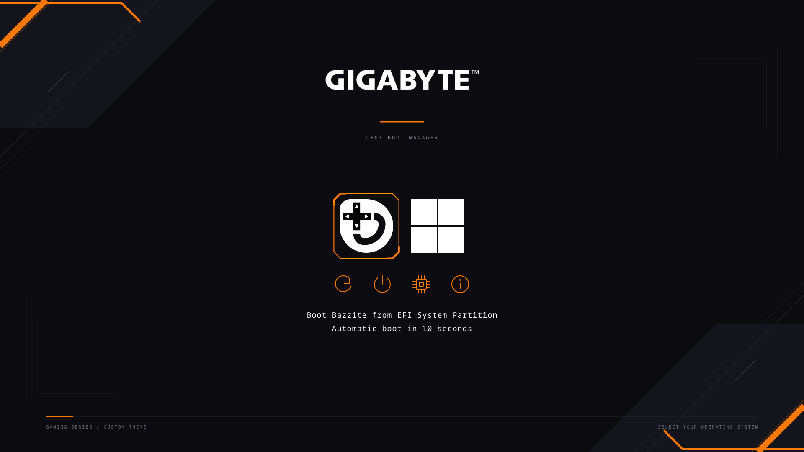

# Auren

Auren is a modern rEFInd boot manager theme with a futuristic, gaming-inspired look. It comes with custom icons, backgrounds, and a clean layout. You can change the colors and branding to match your setup.

A simple tool for customizing the existing black-and-orange Gigabyte rEFInd theme.



## Start here

Open a terminal in this folder and run:

```bash
bash start.sh
```

Choose **Preview**, **Customize**, **Install theme**, **Undo last install**, or **Status**. Previewing and editing do not change your boot setup. Installing asks for administrator authentication.

## Quick commands

```bash
bash start.sh preview
bash start.sh customize --accent '#FF7900' --os-size 144 --utility-size 64
bash start.sh customize --background /path/to/wallpaper.png
bash start.sh customize --resolution 1920x1080 --labels on
bash start.sh install
bash start.sh restore
bash start.sh status
```

`build` generates assets without opening the preview. `doctor` checks requirements. All commands also work as `python3 auren.py COMMAND`.

The install command applies the latest generated theme to an **existing rEFInd installation at `/boot/efi/EFI/refind`**. It is not a general dual-boot or bootloader installer. It preserves loader paths, OS partition selections, timeout/default settings, EFI executables and boot order. It adjusts only the theme include and explicit Bazzite/Windows icon paths. More than one active theme include is rejected for review.

## Make it yours

Edit **`theme.json`**. It is the only settings file you normally need.

| Setting | What it changes |
|---|---|
| `accent` | Highlight and utility color, for example `#FF7900` |
| `resolution` | Canvas and requested firmware resolution, for example `[1920, 1080]` |
| `os_icon_size` | OS image size; default `144` |
| `utility_icon_size` | Utility image canvas; default `64` |
| `show_labels` | Show the selected boot description and countdown |
| `background` | Existing wallpaper file; relative paths are relative to this project |
| `render_background_svg` | Set `true` to render the editable background SVG instead of the wallpaper file |
| `utilities` | Any unique subset of `reboot`, `shutdown`, `firmware`, `about` |

After editing, run `bash start.sh preview`, then `bash start.sh install` when satisfied.

The default background remains the approved Gigabyte artwork. Changing `accent` changes icons/selection frames; set `render_background_svg` to `true` to also recolor the orange geometry in the SVG background. Changing sizes adjusts native rEFInd tiles and spacing; there is no arbitrary CSS-style layout or animation support.

For custom icons, edit the files in **`sources/`**. Keep their transparent backgrounds and filenames. Builds export SVGs to PNG without rewriting the sources. `assets/` contains the shipped PNGs and background. The preview uses the same exported icons, font atlas and rEFInd tile formulas as the theme. Live countdown wording and available GOP display modes can differ from the preview.

## Undo an installation

`bash start.sh restore` undoes the most recent installation made by this project. The tool retains one restore point under `/var/lib/auren-refind/last-install`; each later install replaces it. Restore refuses to overwrite a main config edited since that install. Existing legacy development backups have been removed; there is no project restore point until you first use this project's install command.

## Requirements

- Linux with Python 3, Pillow and ImageMagick (`magick`).
- An existing rEFInd installation for applying the theme.
- `pkexec`, `findmnt` and `efibootmgr` for authenticated installation and checks.
- A graphical session and `xdg-open` to open the preview automatically.

Run `bash start.sh doctor` to check. If Pillow is missing, install your distribution's Python Pillow package or use a virtual environment with `pip install -r requirements.txt`. Preview generation is portable; the installation command currently expects the standard `/boot/efi/EFI/refind` layout. Fonts are shipped as an existing native PNG atlas, so no font installation is required.

## Existing boot manager and recovery

On this machine, the corrected signed rEFInd core is already installed and its signing certificate enrolled. The optional `refind-integrity.service` checks it at startup and shutdown/reboot. Its live files are independent of this project location:

- `/etc/refind/`: guard scripts and protected signing keys.
- `/var/lib/refind-integrity/`: pinned, verified recovery executable, public certificate and status.
- `/etc/systemd/system/refind-integrity.service`: lifecycle checks.

These are active recovery components, **not disposable development backups**. They remain in place. The theme tool never changes the signing key, recovery baseline or bootloader binary. Secure Boot needs no new enrollment for theme changes.

```bash
python3 /etc/refind/integrity-guard.py status
journalctl -u refind-integrity.service --no-pager
```

## Project layout

```text
auren.py             Menu and build/install/restore commands
start.sh             Portable launcher
theme.json           User settings
preview.png          Latest preview
sources/             Editable SVGs and verified logo sources
assets/              Shipped PNG assets
build/               Generated theme; safe to regenerate
system/              Source copies of the optional recovery guard
developer/           Corrected rEFInd source, GNU-EFI inputs and developer notes
```

The core project has no dependency on the former home-directory work folders. No private signing keys are bundled. `developer/refind-x64.signed.efi` is a reference artifact signed for **this machine's enrolled key**; it is not a universally trusted bootloader for other users. Normal customization uses only `auren.py` and never installs that executable.

## Credits

GIGABYTE wordmark: official white artwork from [GIGABYTE's logo package](https://download.gigabyte.com/FileList/Brand/GIGABYTE_Logo.zip), embedded unmodified in the background source. Bazzite mark: installed official Bazzite white SVG. Windows icon: geometric four-pane glyph. Utility icons and decorative geometry: editable project SVGs. These trademarks remain their owners' property; this is a personal custom theme, not an official Gigabyte product.

The included rEFInd source retains its GPL license and notices. GNU-EFI inputs retain their bundled notices. This project's original Python/shell tooling is MIT licensed; logo and third-party software licenses are separate. See `LICENSE` and `developer/README.md`.
